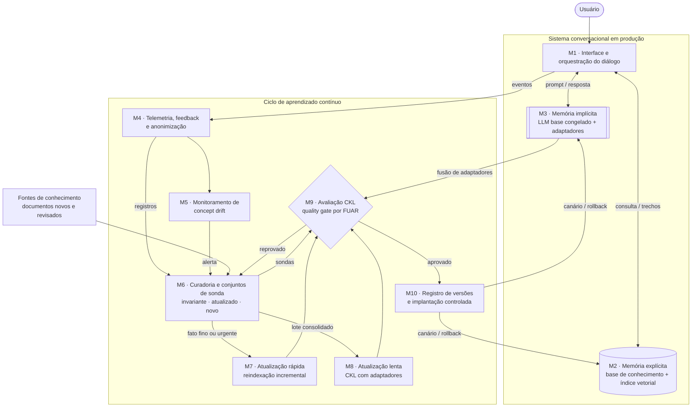

# Atividade Ponderada 3: Aprendizado contínuo em sistemas conversacionais

**Autoestudo 3 · Alternativa 1** (aprendizado contínuo / MLOps)

## Sumário

- [1. Introdução](#1-introdução)
  - [1.1 Contexto e sistema de referência](#11-contexto-e-sistema-de-referência)
  - [1.2 O problema](#12-o-problema)
  - [1.3 Concept drift](#13-concept-drift)
  - [1.4 Por que atualizar não é trivial](#14-por-que-atualizar-não-é-trivial)
  - [1.5 Objetivo e critérios de sucesso](#15-objetivo-e-critérios-de-sucesso)
- [2. Solução proposta](#2-solução-proposta)
  - [2.1 Princípio: duas velocidades, um critério](#21-princípio-duas-velocidades-um-critério)
  - [2.2 Diagrama de blocos da arquitetura](#22-diagrama-de-blocos-da-arquitetura)
  - [2.3 Responsabilidades de cada módulo](#23-responsabilidades-de-cada-módulo)
  - [2.4 Um ciclo completo](#24-um-ciclo-completo)
  - [2.5 Gatilhos de atualização](#25-gatilhos-de-atualização)
  - [2.6 Limitações e objeções](#26-limitações-e-objeções)
- [3. Conclusão](#3-conclusão)
  - [3.1 Considerações pessoais](#31-considerações-pessoais)
  - [3.2 Esforço de implementação](#32-esforço-de-implementação)
- [4. Referências](#4-referências)

## 1. Introdução

### 1.1 Contexto e sistema de referência

Este trabalho propõe um processo de aprendizado contínuo para um sistema conversacional. O sistema de referência, de domínio ilustrativo, é um assistente de atendimento ao cliente com:

- **LLM de pesos abertos e só-decodificador**, ajustável pelo time, condição para a atualização implícita (que altera parâmetros); o corpus original de pré-treino do LLM não está disponível;
- **RAG** sobre uma base de conhecimento com políticas, produtos e procedimentos (LEWIS et al., 2020);
- **registro de interações e de feedback** do usuário.

Se o LLM fosse fechado e acessado por API, como no projeto em grupo deste módulo, só o caminho explícito da seção 2 se aplicaria.

### 1.2 O problema

Um modelo de linguagem (LM) guarda conhecimento de mundo nos parâmetros durante o pré-treino. Esse conhecimento congela na data de corte, mas o mundo muda (JANG et al., 2022, seção 1). No assistente, isso aparece como uma política de troca revisada ou um produto lançado após o corte.

Retreinar do zero resolve, mas tem alto custo computacional (JANG et al., 2022, seção 2). A alternativa comum é a atualização ad hoc: editar prompts e reajustar o modelo sem critério de aceite. Sculley et al. (2015) mostram que mudanças sem controle, dependências implícitas e ciclos de feedback não monitorados acumulam dívida técnica em sistemas de aprendizado de máquina. Interpreta-se que a atualização ad hoc de um assistente tem o mesmo perfil e que a atualização de conhecimento precisa de gatilhos, avaliação e versionamento.

Em termos de aprendizado de máquina, o modelo foi treinado sob a distribuição de dados do momento do corte e passa a operar sob outra; esse descompasso é o concept drift, definido a seguir.

### 1.3 Concept drift

**Definição.** Concept drift é a mudança, ao longo do tempo, da distribuição conjunta que gera os dados (WIDMER; KUBAT, 1996; GAMA et al., 2014):

```math
P_{t_0}(X, y) \neq P_{t_1}(X, y)
```

No assistente, $X$ é a pergunta com o contexto do diálogo, e $y$ é a resposta correta.

**Drift real e virtual.** Gama et al. (2014) separam dois casos. No drift real, $P(y \mid X)$ muda: a mesma pergunta passa a ter outra resposta correta. No drift virtual, muda só $P(X)$: os usuários perguntam outras coisas, mas a resposta correta de cada pergunta se mantém.

**Padrões temporais.** Lu et al. (2019) descrevem quatro padrões: abrupto (a política muda em uma data), gradual (o conceito novo substitui o antigo com alternância), incremental (o conceito se desloca por estados intermediários) e recorrente (um conceito antigo volta, como uma campanha sazonal).

**Ponte com o CKL.** A tabela relaciona os três tipos de conhecimento de Jang et al. (2022, seção 3.1) ao concept drift. **A correspondência é uma interpretação deste trabalho**; o artigo não usa o termo concept drift.

| Tipo de conhecimento (CKL) | Relação com concept drift | Exemplo no assistente | Risco se não tratado |
|---|---|---|---|
| Invariante | Ausência de drift; lado da estabilidade no dilema estabilidade-plasticidade (PARISI et al., 2019) | "Em que ano a empresa foi fundada?"; também "Qual era o prazo de troca em 2025?", pois fatos com data fixa contam como invariantes (JANG et al., 2022, seção 3.1) | Esquecimento catastrófico ao treinar com dados novos (KIRKPATRICK et al., 2017) |
| Atualizado | Drift real: $P(y \mid X)$ muda; mesma pergunta, nova resposta | "Qual é o prazo para troca?" passa de 7 para 30 dias (hipotético) | Resposta desatualizada dada com confiança |
| Novo | Mudança em $P(X)$ próxima do drift virtual, mas com regiões de $X$ que o modelo nunca viu: a resposta correta existe, o modelo é que não a tem | Perguntas sobre um produto lançado após o corte | Recusa, resposta genérica ou alucinação |

### 1.4 Por que atualizar não é trivial

Continuar o pré-treino em um corpus novo causa esquecimento catastrófico: o modelo perde o que sabia enquanto aprende o novo (KIRKPATRICK et al., 2017; JANG et al., 2022, seção 2). Na Tabela 2 de Jang et al. (2022), o T5 sem mitigação (Vanilla) cai de 24,17 para 12,89 de *exact match* (EM) no InvariantLAMA.

Jang et al. (2022, apêndice A.3) distinguem métodos explícitos, que guardam o conhecimento fora dos parâmetros, e implícitos, que os alteram. O RAG é explícito: atualizar é trocar o índice de documentos (LEWIS et al., 2020). Isso é barato, mas não basta. O artigo relata que modelos com memória externa ainda alucinam mesmo quando recebem o conhecimento atualizado na inferência (JANG et al., 2022, seção 2).

### 1.5 Objetivo e critérios de sucesso

**Objetivo:** manter o conhecimento do assistente atualizado, com esquecimento controlado e mensurável.

**Critérios** (valores iniciais propostos, a calibrar na linha de base):

1. **FUAR < 1** em todo ciclo aprovado que tenha ganho (cálculo em M9). Para Jang et al. (2022, seção 3.2), FUAR abaixo de 1 indica que o modelo ganha mais conhecimento novo ou atualizado do que perde. Atualizações neutras (do caminho rápido e da fusão de adaptadores) seguem a regra própria descrita em M9.
2. **Queda máxima de 1 ponto percentual** (tolerância $\tau$) na exatidão da sonda invariante por ciclo, medida com o sistema completo, nos mesmos itens antes e depois da mudança. O tamanho da sonda é dimensionado na linha de base para que uma queda de $\tau$ seja distinguível do ruído amostral. Para o caminho lento, aplica-se também uma tolerância sem recuperação, $\tau_{\text{cb}}$ (valor inicial: 3 p.p.), porque o RAG mascara perdas paramétricas em produção (ver M9).
3. **Itens urgentes em produção em até 24 horas** da publicação, e itens do lote diário em até 48 horas, incluindo gate e canário.
4. **100% das respostas** rastreáveis às versões de índice, adaptador e prompt.

## 2. Solução proposta

### 2.1 Princípio: duas velocidades, um critério

Propõe-se atualizar o conhecimento por dois caminhos, avaliados pelo mesmo critério.

**Caminho rápido (explícito).** Fatos novos e alterados, sobretudo os de granularidade fina, entram na base com data de vigência, e o índice é atualizado de forma incremental. Justificativa: no T5-Vanilla, o conhecimento atualizado (UpdatedLAMA, EM 10,17) foi aprendido melhor que o novo (NewLAMA, EM 3,77). Os autores conjecturam que o novo exige conhecimento mais fino, que provavelmente aparece menos no corpus (JANG et al., 2022, apêndice I). Interpreta-se que fatos finos e raros são candidatos fracos ao treino e devem ir para a memória explícita.

**Caminho lento (implícito).** Periodicamente, conhecimento consolidado e frequente (terminologia, catálogo estável, políticas assentadas) é incorporado ao LLM por pré-treino contínuo com LoRA (HU et al., 2022): o modelo base fica congelado e só um adaptador de baixo posto é treinado. Justificativas: (a) na Tabela 2 de Jang et al. (2022), a expansão de parâmetros teve os menores FUAR no T5 (Modular 0,28; K-Adapter com k=2 0,33; LoRA 0,55), contra Vanilla 1,08, RecAdam 0,84 e Mix-Review 1,74; (b) entre os métodos de expansão, escolhe-se o LoRA por três razões do próprio artigo: é o que menos acrescenta parâmetros (738M no total, contra 762M do K-Adapter com k=2 e 773M do Modular, sobre os 737M do T5 inicial, na Tabela 2), o que atenua a ineficiência de memória apontada na seção 5.2; o Modular é específico para modelos codificador-decodificador (seção 4), e o sistema de referência usa um LLM só-decodificador; e, no GPT-2, que é só-decodificador, o LoRA teve FUAR 0,06, empatado com o K-Adapter (k=3) e atrás apenas do Mix-Review (0) (Tabela 10); (c) o Mix-Review fica fora porque exige acesso ao corpus original de pré-treino (seção 4), indisponível no sistema de referência; (d) o caminho implícito responde ao limite do RAG descrito na seção 1.4.

**Critério único.** Os dois caminhos passam pelo mesmo *quality gate*, derivado do FUAR. Uma reindexação também pode "esquecer", por exemplo ao remover um trecho que respondia uma pergunta invariante.

**Enquadramento em MLOps.** Kreuzberger, Kühl e Hirschl (2023) listam, entre os princípios de MLOps, o treinamento e a avaliação contínuos (CT), o versionamento, o monitoramento contínuo e os ciclos de feedback. A proposta instancia os quatro: M8 e M9 (CT), M10 (versionamento), M5 (monitoramento) e o fluxo M4 → M6 (feedback). O artefato versionado inclui índice e adaptadores, não só pesos.

### 2.2 Diagrama de blocos da arquitetura



### 2.3 Responsabilidades de cada módulo

#### M1 · Interface e orquestração do diálogo

- **Responsabilidade:** consultar M2, montar o prompt e chamar M3. Em conflito entre trecho recuperado e conhecimento paramétrico, o prompt manda seguir o trecho vigente.
- **Entradas:** mensagem, histórico, trechos de M2.
- **Saídas:** resposta; evento para M4.
- **Gatilho:** cada mensagem.
- **Métrica:** latência por turno; fração de respostas apoiadas em trecho.

#### M2 · Memória explícita (base de conhecimento + índice vetorial)

- **Responsabilidade:** guardar trechos com metadados de vigência (início, fim, versão, fonte). Documento revogado sai do índice. Em conflito entre versões, prevalece a de vigência mais recente.
- **Entradas:** versões de índice promovidas por M10.
- **Saídas:** trechos ranqueados com metadados.
- **Gatilho:** consulta de M1; promoção de versão.
- **Métrica:** revocação@k nas sondas; trechos vencidos no índice (alvo: zero).

#### M3 · Memória implícita (LLM base congelado + adaptadores)

- **Responsabilidade:** gerar a resposta com o modelo base congelado e um adaptador LoRA por fase do caminho lento. Mesmo com LoRA, que acrescenta poucos parâmetros por fase, o número de adaptadores cresce a cada fase; o artigo aponta esse crescimento como limitação da expansão de parâmetros (o T5-Modular soma 36M por rodada; JANG et al., 2022, seção 5.2). Para contê-lo, propõe-se limitar os adaptadores ativos (valor inicial: 3). No limite, os adaptadores mais antigos são fundidos nos pesos do modelo base ($W' = W + \sum_i B_i A_i$), operação que o LoRA permite sem latência adicional na inferência (HU et al., 2022); o modelo fundido passa a ser o novo modelo base congelado. A fusão não exige retreino, então não recicla corpus, mas elimina o rollback por remoção de adaptador; por isso, a versão anterior do modelo base fica registrada em M10, e a fusão passa por M9 como caso neutro (ver M9). Esta regra de consolidação é proposta deste trabalho; Jang et al. (2022) não a testam.
- **Entradas:** prompt de M1; adaptadores promovidos por M10.
- **Saídas:** texto da resposta; fusão de adaptadores candidata para M9.
- **Gatilho:** chamada de M1; troca de adaptador.
- **Métrica:** adaptadores ativos; memória ocupada; latência.

#### M4 · Telemetria, feedback e anonimização

- **Responsabilidade:** registrar cada interação com as versões de índice, adaptador e prompt. Capturar feedback explícito (avaliação do usuário) e implícito (reformulação, transbordo para humano, abandono). Remover ou pseudonimizar dados pessoais antes de persistir, conforme a LGPD (BRASIL, 2018).
- **Entradas:** eventos de M1.
- **Saídas:** registros anonimizados para M5 e M6.
- **Gatilho:** cada evento.
- **Métrica:** registros com as três versões (alvo: 100%); dados pessoais em auditoria amostral (alvo: zero).

#### M5 · Monitoramento de concept drift

- **Responsabilidade:** detectar drift em fluxo com três sinais: feedback negativo, perguntas fora do domínio e queda da similaridade pergunta–trecho recuperado. Cada sinal alimenta um ADWIN, que mantém uma janela adaptativa e a corta quando duas subjanelas têm médias significativamente diferentes (BIFET; GAVALDÀ, 2007). Interpreta-se que feedback negativo em tópico conhecido sugere drift real, e alta de perguntas fora do domínio sugere novas regiões de $X$.
- **Entradas:** registros de M4.
- **Saídas:** alerta com sinal, tópico e janela para M6.
- **Gatilho:** contínuo.
- **Métrica:** atraso de detecção; fração de alertas descartados na curadoria.

#### M6 · Curadoria e conjuntos de sonda

- **Responsabilidade:** classificar cada item como invariante, atualizado ou novo (JANG et al., 2022, seção 3.1). Manter três conjuntos de sonda inspirados em InvariantLAMA, UpdatedLAMA e NewLAMA: pares pergunta–resposta verificados por humanos, divididos em validação e teste. Deduplicar o corpus de atualização, pois ver os mesmos dados repetidamente é causa crítica de esquecimento (JANG et al., 2022, seção 5.2, figura 3). Decidir o caminho: fato fino ou urgente vai para M7; consolidado e frequente, para o lote de M8.
- **Entradas:** alertas de M5; registros anonimizados de M4 (perguntas reais para as sondas); documentos das fontes; reprovações de M9.
- **Saídas:** itens roteados; sondas versionadas.
- **Gatilho:** alerta, publicação ou reprovação.
- **Métrica:** tempo de curadoria por item; concordância entre curadores.

#### M7 · Atualização rápida (reindexação incremental)

- **Responsabilidade:** gerar um índice candidato com trechos novos, substituídos e revogados. Cada versão é identificada; a anterior fica para rollback.
- **Entradas:** itens de M6.
- **Saídas:** índice candidato para M9.
- **Gatilho:** item urgente (imediato) ou lote diário.
- **Métrica:** tempo entre publicação e candidato.

#### M8 · Atualização lenta (CKL com adaptadores)

- **Responsabilidade:** treinar um adaptador LoRA sobre o lote consolidado, com o modelo base congelado. Regras derivadas do artigo:
  - poucas épocas, sem reciclar o mesmo corpus (JANG et al., 2022, seção 5.2);
  - taxa de aprendizado escolhida na validação das sondas, no modo sem recuperação (ver M9); taxa menor reduz esquecimento e aprendizado, e não há regra geral (JANG et al., 2022, apêndice E, tabela 7);
  - agrupar atualizações para reduzir o número de fases, pois múltiplas fases aumentaram o esquecimento, possivelmente pelo reinício do agendamento da taxa de aprendizado (JANG et al., 2022, seção 5.2).
- **Entradas:** lote deduplicado; sondas de validação.
- **Saídas:** adaptador candidato para M9.
- **Gatilho:** agenda mensal, condicionada a um volume mínimo de itens.
- **Métrica:** exatidão na validação; GPU-hora por ciclo.

#### M9 · Avaliação CKL (quality gate por FUAR)

- **Responsabilidade:** comparar candidato e produção nas sondas de teste. Sejam $I$, $A$ e $N$ as exatidões nas sondas invariante, atualizado e novo. Propõe-se um FUAR adaptado:

  ```math
  \text{FUAR}_{\text{adapt}} = \frac{\max(0,\ I_{\text{prod}} - I_{\text{cand}})}{\max(0,\ A_{\text{cand}} - A_{\text{prod}}) + \max(0,\ N_{\text{cand}} - N_{\text{prod}})}
  ```

  No artigo, o FUAR compara o modelo da última fase com o de cada fase anterior e soma as diferenças (JANG et al., 2022, seção 3.2, equação 1); aqui, a referência é só a versão em produção (adaptação deste trabalho). O gate aprova se $\text{FUAR}_{\text{adapt}} < 1$ e $I_{\text{prod}} - I_{\text{cand}} \le \tau$. Denominador zero é "no gain", o pior caso (JANG et al., 2022, seção 3.2). Para candidatos de M8, isso reprova: um adaptador que não ganha nada só acrescenta parâmetros. Para candidatos de M7, perda sem ganho (numerador positivo e denominador zero) também reprova. Já o caso neutro, com numerador e denominador zero, é tratado à parte para candidatos de M7 e para fusões de adaptadores (M3). Em M7, ele cobre reformulações, correções de texto e trechos sem item de sonda, e o índice candidato é aprovado como manutenção desde que a revocação@k nas sondas não caia. Na fusão, que deve reproduzir as saídas dos adaptadores ativos, a aprovação exige que $I$, $A$ e $N$ se mantenham dentro das tolerâncias $\tau$ (com recuperação) e $\tau_{\text{cb}}$ (sem recuperação). Uma revogação sem substituto entra na sonda de atualizado com resposta esperada "não vigente", para que remoções não passem como neutras. O gate vale para os dois caminhos.

  **Modo de avaliação.** Candidatos de M7 são avaliados com o sistema completo, com recuperação. Candidatos de M8 são avaliados também sem recuperação (*closed-book*), como na sondagem zero-shot do artigo, que mede o conhecimento guardado nos parâmetros (JANG et al., 2022, seção 3.1). Sem esse modo, o ganho do caminho lento ficaria mascarado: o RAG já responde aos itens do lote, $A$ e $N$ não mudam e o candidato seria sempre reprovado como "no gain". Para M8, o gate exige $\text{FUAR}_{\text{adapt}} < 1$ sem recuperação, queda $\le \tau$ no invariante com o sistema completo e queda $\le \tau_{\text{cb}}$ no invariante sem recuperação.
- **Entradas:** candidato de M7 ou M8, ou fusão proposta por M3; produção; sondas de teste.
- **Saídas:** decisão e relatório para M10 ou M6.
- **Gatilho:** cada candidato.
- **Métrica:** $\text{FUAR}_{\text{adapt}}$; variações de $I$, $A$ e $N$; tempo de avaliação (alvo para candidatos de M7: até 4 horas, para que os prazos do critério 3 da seção 1.5 se cumpram).

#### M10 · Registro de versões e implantação controlada

- **Responsabilidade:** registrar índice, adaptadores, versões do modelo base (inclusive a anterior a cada fusão), prompts e sondas com o relatório de M9. Implantar em canário (proposta: 5% do tráfego, por 2 horas para itens urgentes, 12 horas para lotes diários e 3 dias para adaptadores, valores a calibrar), comparar os sinais de M5 com a produção e promover ou fazer rollback. Para candidatos de M8, o canário compara também a taxa de feedback negativo nas interações em que M2 não retornou trecho acima do limiar de similaridade, que é onde o conhecimento paramétrico decide a resposta.
- **Entradas:** candidato aprovado.
- **Saídas:** versão ativa em M2 e M3.
- **Gatilho:** aprovação em M9; alarme no canário.
- **Métrica:** tempo de rollback; incidentes após promoção.

### 2.4 Um ciclo completo

Cenário hipotético: o prazo de troca passa de 7 para 30 dias e, no mesmo mês, é lançado um fone de ouvido novo.

1. A política revisada é publicada. M6 a classifica como **atualizado**, fino e urgente, e a envia a M7. "Qual é o prazo para troca?" entra na sonda de atualizado com resposta "30 dias".
2. M7 gera o índice candidato: trecho novo com vigência, trecho antigo removido.
3. Em M9, $I$ se mantém e $A$ sobe; $\text{FUAR}_{\text{adapt}} = 0$. M10 faz o canário e promove.
4. O fone sai com documentação incompleta. O ADWIN de M5 detecta alta de perguntas fora do domínio.
5. O curador cria trechos e itens na sonda de **novo**; repete-se M7 → M9 → M10.
6. No fim do mês, M6 monta o lote deduplicado do caminho lento (catálogo do fone, política já estável), e M8 treina um adaptador, avaliado em M9 sem recuperação e com o sistema completo. Se M9 reprovar, M6 revisa o lote ou a taxa de aprendizado.

### 2.5 Gatilhos de atualização

O caminho rápido reage a eventos e alarmes; o lento segue agenda. Os limiares são propostas iniciais.

| Sinal | Como medir | Limiar inicial (calibrado na linha de base) | Ação |
|---|---|---|---|
| Documento publicado ou revisado | Evento nas fontes | Qualquer ocorrência | M6 → M7 |
| Feedback negativo por tópico | Taxa por janela, com ADWIN | Mudança detectada e taxa acima da linha de base | M6 revisa trechos do tópico |
| Perguntas fora do domínio | Fração sem trecho acima do limiar de similaridade | Mudança detectada pelo ADWIN | M6 cria itens "novo" |
| Similaridade pergunta–trecho | Média por janela | Queda detectada pelo ADWIN | M6 revisa cobertura do índice |
| Agenda do caminho lento | Calendário | Mensal, com volume mínimo de itens | M6 → M8 |
| Alarme no canário | Sinais de M5, canário vs. produção | Piora significativa em qualquer sinal | Rollback em M10 |

### 2.6 Limitações e objeções

- **Transferência.** Os resultados de Jang et al. (2022) vêm de T5 e GPT-2 com sondas cloze, não de um assistente em produção.
- **Dependência de arquitetura.** O *rehearsal* (Mix-Review) foi o pior no T5 (FUAR 1,74, Tabela 2) e teve FUAR 0 no GPT-2 (Tabela 10). Os autores atribuem parte da diferença à taxa de aprendizado e ao método de avaliação (JANG et al., 2022, apêndice G). A escolha de LoRA precisa ser validada no próprio sistema.
- **Configuração.** No T5, o artigo congela só o codificador e treina o decodificador junto com LoRA e K-Adapter; no GPT-2, só-decodificador, congela o modelo inteiro (JANG et al., 2022, apêndice D). A proposta segue a configuração do GPT-2. Ainda assim, o FUAR de 0,06 do LoRA no GPT-2 foi medido com um ajuste leve antes da avaliação, não por sondagem zero-shot (apêndices C e G), e precisa ser reproduzido no próprio sistema.
- **Fases acumuladas.** Agrupar atualizações reduz o número de fases, mas não elimina o esquecimento acumulado (JANG et al., 2022, seção 5.2).
- **Escopo do FUAR.** O FUAR não mede fluência, segurança nem tom; o gate precisa de avaliações conversacionais complementares.
- **Sondas.** Sondas pequenas ou enviesadas tornam o FUAR instável.

## 3. Conclusão

### 3.1 Considerações pessoais

Confesso que comecei este autoestudo achando que o RAG resolvia o problema sozinho: mudou o documento, mudou a resposta. O artigo me tirou dessa certeza. Saber que modelos com memória externa ainda alucinam mesmo recebendo a informação atualizada foi o que me levou a desenhar dois caminhos em vez de um. Outra coisa que me pegou de surpresa foi o rehearsal ter sido o pior método no T5, porque, por intuição, era nele que eu teria apostado.

Dito isso, sou mais cético com o caminho lento do que o texto talvez deixe transparecer. No projeto do meu módulo, por exemplo, usamos LLM via API, então essa parte nem seria possível. E, mesmo com pesos abertos, treinar um adaptador por mês exige GPU, sondas bem construídas e alguém acompanhando o FUAR de perto. Na minha visão, o gargalo real nem é técnico, é a curadoria: sem alguém classificando o que é invariante, atualizado ou novo, o resto da arquitetura não sai do papel.

Se eu fosse implementar de verdade, começaria pela telemetria e pelas sondas e, em seguida, faria o caminho rápido com o gate. Pensando no meu próprio e-commerce, onde política de troca e catálogo mudam o tempo todo, só isso já resolveria a maior parte do problema sem gastar nada com GPU. O caminho lento eu deixaria para depois, quando os dados mostrassem que o RAG sozinho está errando.

### 3.2 Esforço de implementação

Estimativas deste trabalho, em ordem de grandeza.

| Fase | Entregas | Esforço | Dependências | Principal risco |
|---|---|---|---|---|
| F1 | Telemetria com versões e anonimização (M4); sondas I/A/N (M6) | 3–4 semanas-pessoa | Acesso aos registros; curadores do domínio | Sondas pequenas ou enviesadas |
| F2 | Monitoramento de drift com ADWIN (M5) | 2 semanas-pessoa | F1 | Falsos alarmes por feedback ruidoso |
| F3 | Caminho rápido (M2 com vigência, M7) e gate FUAR (M9) | 3–4 semanas-pessoa | F1 | Conflito entre versões de documentos |
| F4 | Caminho lento com LoRA (M3, M8) | 4–6 semanas-pessoa, mais GPU | F1, F3; LLM de pesos abertos | Esquecimento acima de $\tau$; custo de GPU |
| F5 | Registro, canário e rollback (M10) | 2–3 semanas-pessoa | F3 | Rollback incompleto |

**Total estimado:** 14 a 19 semanas-pessoa, mais GPU para F4. O MVP abaixo soma cerca de 7 a 9 semanas-pessoa.

**Custo de referência para F4.** Jang et al. (2022) treinaram um T5 de cerca de 737M parâmetros em 4 GPUs V100 de 32 GB (apêndice C), sobre um corpus novo de cerca de 168M tokens, cerca de 750 vezes menor que o C4 (seção 3.1, nota 2).

**Custo recorrente.** Curadoria dos itens e rotulagem das sondas, proporcionais ao volume de mudanças; estima-se uma pessoa em tempo parcial.

**MVP.** F1 + F3 + rollback de índice (parte de F5): caminho rápido com gate, sem GPU. F2 e F4 vêm depois da linha de base.

## 4. Referências

BIFET, A.; GAVALDÀ, R. Learning from time-changing data with adaptive windowing. In: SIAM INTERNATIONAL CONFERENCE ON DATA MINING, 7., 2007, Minneapolis. **Proceedings** [...]. Philadelphia: SIAM, 2007. p. 443-448.

BRASIL. Lei nº 13.709, de 14 de agosto de 2018. Lei Geral de Proteção de Dados Pessoais (LGPD). Brasília, DF: Presidência da República, 2018. Disponível em: https://www.planalto.gov.br/ccivil_03/_ato2015-2018/2018/lei/l13709.htm. Acesso em: 5 out. 2026.

GAMA, J. et al. A survey on concept drift adaptation. **ACM Computing Surveys**, v. 46, n. 4, p. 1-37, 2014. DOI: 10.1145/2523813.

HU, E. J. et al. LoRA: low-rank adaptation of large language models. In: INTERNATIONAL CONFERENCE ON LEARNING REPRESENTATIONS, 10., 2022, [S. l.]. **Proceedings** [...]. [S. l.: s. n.], 2022. Disponível em: https://arxiv.org/abs/2106.09685. Acesso em: 5 out. 2026.

JANG, J. et al. Towards continual knowledge learning of language models. In: INTERNATIONAL CONFERENCE ON LEARNING REPRESENTATIONS, 10., 2022, [S. l.]. **Proceedings** [...]. [S. l.: s. n.], 2022. Disponível em: https://arxiv.org/abs/2110.03215. Acesso em: 5 out. 2026.

KIRKPATRICK, J. et al. Overcoming catastrophic forgetting in neural networks. **Proceedings of the National Academy of Sciences**, v. 114, n. 13, p. 3521-3526, 2017. DOI: 10.1073/pnas.1611835114.

KREUZBERGER, D.; KÜHL, N.; HIRSCHL, S. Machine Learning Operations (MLOps): overview, definition, and architecture. **IEEE Access**, v. 11, p. 31866-31879, 2023. DOI: 10.1109/ACCESS.2023.3262138.

LEWIS, P. et al. Retrieval-augmented generation for knowledge-intensive NLP tasks. In: LAROCHELLE, H. et al. (ed.). **Advances in Neural Information Processing Systems 33**. Red Hook: Curran Associates, 2020. p. 9459-9474.

LU, J. et al. Learning under concept drift: a review. **IEEE Transactions on Knowledge and Data Engineering**, v. 31, n. 12, p. 2346-2363, 2019. DOI: 10.1109/TKDE.2018.2876857.

PARISI, G. I. et al. Continual lifelong learning with neural networks: a review. **Neural Networks**, v. 113, p. 54-71, 2019. DOI: 10.1016/j.neunet.2019.01.012.

SCULLEY, D. et al. Hidden technical debt in machine learning systems. In: CORTES, C. et al. (ed.). **Advances in Neural Information Processing Systems 28**. Red Hook: Curran Associates, 2015. p. 2503-2511.

WIDMER, G.; KUBAT, M. Learning in the presence of concept drift and hidden contexts. **Machine Learning**, v. 23, n. 1, p. 69-101, 1996. DOI: 10.1007/BF00116900.
